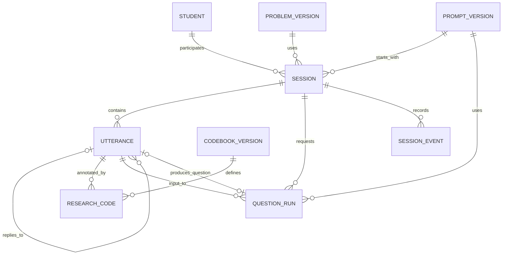

# 삼각비 챗봇 연구자료 데이터 설계

작성일: 2026-10-14 / 설계 버전: `trig-data-v0.1-draft`

상태: 연구자 검토용 설계안. 코드·SQL·데이터베이스·실제 AI 호출을 만들거나 실행하지 않았다.

## 1. 근거와 범위

`01_연구프로토콜.md`를 읽고, 앞선 대화에서 작성한 질문 규칙을 참조했다. 이번 확인 시 현재 폴더에 `04_챗봇질문규칙.md`가 발견되지 않아 파일 자체를 재확인하지 못했다. 참조한 질문 규칙 버전은 대화에 남은 `trig-question-v0.1-draft`이다. 문서 파일의 상태는 확인 필요이며, 기존 파일을 복원하거나 덮어쓰지 않았다.

한 학생은 여러 활동을 할 수 있고, 한 활동은 여러 학생 발화와 AI 질문을 포함한다. 첫 시험판은 활동당 문제 한 개로 설계한다. 여러 문제를 한 활동에 넣는 기능은 이번 범위에서 제외한다.

재응시를 저장할 수 있는 구조와 재응시를 허용하는 운영 정책은 다르다. 재응시·재개 허용 여부, 학생 ID의 개인정보 해당 여부, 실제 저장 위치·열람 대상·보관 기간은 연구자가 결정한다. 기존 앱의 `localStorage` 저장 정책을 변경하지 않는다.

아래 자료 영역과 검증·복구 규칙은 모두 설계 제안이다. 실제 테이블이 이미 만들어졌다는 뜻이 아니다.

## 2. 데이터 관계도

`1:N`은 하나에 여러 개가 연결된다는 뜻이다. ID는 각 자료를 구분하는 고유 번호이다.



問題版とプロンプト版は変更しない資料として保管する。`QUESTION_RUN`は質問生成の処理記録であり、失敗・検証不合格も含む。学生に表示することが確定したAI質問だけを `UTTERANCE` に入れる。システム案内・終了要求・保存エラーは `SESSION_EVENT` に入れ、学習質問と区別する。

※ 上の関係の説明を日本語表記にしたが、意味は次のとおりである。問題版とプロンプト版は変更せず保存する。質問生成記録には失敗も残し、確定した学習質問だけを発話として扱う。

## 3. 共通の記録規則

- `null`は「値がない／該当しない」を示す。未分析、取得不能、保存失敗は専用の状態項目で区別し、すべてをnullだけで表さない。
- 日時はISO 8601形式のUTCで保存する案とする。例: `2026-10-14T01:00:00Z`。表示時に日本時間へ変換する。この例は日本時間10:00である。
- 対話順は日時だけで並べず、活動内の `sequence_no` を使う。端末の時計がずれても発話順を再現できるようにする。
- IDは全体で一意の値とし、例にある読みやすい番号は説明用に限る。実装時の生成方式は後続計画で決める。
- 元の発話は改変しない。研究者の訂正・分析・匿名化した書き出しは別資料にし、原文を上書きしない。
- 学生画面に必要な文章と研究用情報を分離する。タイプ・分析コード・プロンプト原文・エラー詳細を学生画面に流さない。
- APIキー、パスワード、認証トークンは研究資料にもプロンプト原文にも保存しない。

## 4. 項目説明表

### 4-1. 学生 `students`

| 項目 | 内容 | 規則・例 |
|---|---|---|
| student_id | 学生を区別するID | 必須・一意。例 `S001`。実名を使うか否かは研究者確認事項 |
| created_at | 記録作成日時 | UTC日時 |

氏名・学校名・メールアドレスは今回の最小構造に追加しない。IDと個人の対応表が必要な場合、別管理の扱いを研究者が定める。IDだけで認証・本人確認やアクセス権が成立するとは考えない。

### 4-2. 問題版 `problem_versions`

| 項目 | 内容 | 規則・例 |
|---|---|---|
| problem_id | 問題自体の識別子 | 例 `TRIG_138_01` |
| problem_version | 使った問題資料の版 | 例 `p1-draft`。problem_idとの組が一意 |
| source_title / source_page / pdf_page | 出典・教科書頁・PDF頁 | 例 教科書138頁、PDF7頁 |
| original_text | 提示する問題原文 | 確認済み原文を保存。要約と混同しない |
| figure_ref / figure_description | 図の保存参照・構造説明 | 必要な頂点、直角、長さ、配置。参照先の資料も同じ版で保持 |
| content_hash | 原文・図の変更検出値 | 同じ版で内容が変わったことを検出するための値。アクセス制御や暗号化ではない |
| review_status | 原文・解答根拠の確認状態 | `draft` / `approved`。実運用はapproved資料のみ |
| created_at | 版作成日時 | 元の版は上書きしない |

図や本文、提示補足に研究条件へ影響する変更をしたら新しい版にする。元の版を新しい版へ付け替えない。解答検討資料は研究者用の別資料として扱う。正式解説との照合は現在確認必要。

### 4-3. プロンプト原文版 `prompt_versions`

| 項目 | 内容 | 規則・例 |
|---|---|---|
| prompt_version | 質問規則パッケージの版 | 例 `trig-question-v0.1-draft`。一意 |
| original_prompt_version | システムプロンプト原文の版 | 例 `trig-system-v0.1-draft`。原文が変われば新しい値 |
| system_prompt_text | 実際に送るシステムプロンプト原文 | 全文保存。ファイル名や版名だけでは不足 |
| context_template_text | 問題・履歴をAIに渡す文面の型 | 追加の運用指示も含めて原文を残す |
| question_rules_version | 質問選択規則の版 | 原文プロンプトと選択規則の対応を記録 |
| prototype_question_set_version / prototype_questions | 例示質問集の版・全文 | prototype時に使用。実AI生成と区別 |
| content_hash / created_at / review_status | 変更検出値・作成日時・承認状態 | 同じ版の原文を後から書き換えない |

`prompt_version`は規則・文面・例示質問集をまとめた版、`original_prompt_version`はそのうちシステムプロンプト全文の版である。全文と型を保持し、生成ごとの実入力も次の生成記録で参照できるようにする。保存範囲とアクセス権は研究者確認後に決める。

### 4-4. 活動 `sessions`

| 項目 | 内容 | 規則・例 |
|---|---|---|
| session_id | 一回の活動のID | 必須・一意。新しい活動は新ID |
| student_id | 参加学生 | studentsに接続。一学生に複数session可 |
| problem_id / problem_version | この活動で使う問題と版 | 対応するproblem_versionsを参照。開始時に固定 |
| mode | 質問生成方式 | `prototype` / `live`。一活動内で切り替えない |
| prompt_version / original_prompt_version | 開始時の規則・原文版 | 承認済みの対応関係を固定 |
| model_version | 開始時のモデル識別情報 | prototypeはnull。liveの正確な記録は生成単位でも保持 |
| started_at | 活動開始日時 | UTC。再読込では変更しない |
| ended_at | 正常終了または中断日時 | 進行中はnull。いずれの終了状態でも必須 |
| status | 活動状態 | `in_progress` / `completed` / `interrupted` |
| end_reason | 終了・中断理由 | 進行中はnull。例 `student_finished`, `student_stop`, `technical_issue`。対応する状態は運用規則で確定 |
| last_sequence_no | 最後に確定した発話順 | 原文ログから一致確認できる要約値 |
| sync_status | 保存先との同期状態 | `pending` / `confirmed` / `failed`。活動状態と別 |
| storage_scope | 保存確認の対象 | `browser_local` / `research_store`。ローカル保存を研究サーバー保存と誤認しない |
| revision / updated_at | 更新競合確認用の版番号・更新時刻 | 古い状態が新しい活動状態を上書きすることを防ぐ案 |

`completed`でも`sync_status=failed`なら「活動は終了しましたが保存できていません」と示す。保存確認後に活動が終了したことにするのではなく、終了事実と保存結果を独立に残す。

モデル・規則変更で活動条件が変わる場合、無記録で切り替えない。原則として次の新活動から適用する案であり、変更・再開許可の運用は別に確定する。

### 4-5. 発話 `utterances`

| 項目 | 内容 | 規則・例 |
|---|---|---|
| utterance_id | 発話番号（全体で一意） | 例 `U_DEMO_001`。識別子であり日時から順を推測しない |
| session_id | 所属活動 | sessionsを参照 |
| sequence_no | 活動内の発話順 | 1から増える整数。同じsession内で重複不可 |
| speaker | 発話者 | `student` / `ai` |
| text_original | 原文 | 確定した学生入力、または確定したAI質問。空白整理した値と原文を混同しない |
| reply_to_utterance_id | 応答対象の発話番号 | 最初の学生発話はnull。AIは対象学生発話、後続学生は対象AI質問を参照 |
| rationality_type | AI質問の主目的 | AIは `epistemic` / `teleological` / `communicative` の一つ。**学生は必ずnull** |
| classification_source | タイプの付与元 | studentはnull。prototypeは`example_author`、liveは`model` |
| timestamp | 発話確定日時 | studentは送信時、aiは検証して質問が確定した時。UTC |
| received_at | 保存先が受け取った日時 | まだ保存されていなければnull。端末時刻と区別 |
| displayed_at | 画面に表示された日時 | 未表示ならnull。AIが生成されたことと実際に表示されたことを区別 |
| mode | この発話の活動条件 | sessionのmodeと一致。studentにも付け、書き出し時に判別可能 |
| prompt_version / original_prompt_version | AI質問が使った規則・原文版 | AIは必須。学生はnull。学生行はsessionから参照可能 |
| model_version / question_run_id | 生成モデルと生成記録 | AI liveは必須、AI prototypeはモデルnull・生成記録あり。学生は両方null |
| client_operation_id | 同じ発話保存操作の識別子 | 最初の送信前に確定。保存の再送でも同じ値 |
| sync_status | 保存状態 | pending / confirmed / failed。研究用の原文とは別の配送情報 |

AI質問だけをこの発話領域に入れるため、AIの全行に三タイプのいずれかが入る。終了案内・「図が見えません」への技術案内・規則検証不合格の生成物はAI質問行に混ぜない。学生の「やめたい」等が送信済みであれば、その原文はstudent行として保存し、終了要求の事実はイベントにも記録する。

最初の発話以外で、表示された質問に対する応答先が不明なら適当に直前番号を代入しない。`unresolved_reply`イベントを残し、研究者確認対象にする。通常の対話は一度に一つの未応答質問だけとする案。

### 4-6. 質問生成 `question_runs`

| 項目 | 内容 | 規則・例 |
|---|---|---|
| question_run_id | 論理的な一回の質問生成ID | 同じ学生発話に返す一つの質問処理を表す |
| session_id / input_utterance_id | 活動と対象学生発話 | 同じ活動のstudent行であることを確認 |
| mode | 例示質問か実AIか | prototype / live |
| prompt_version / original_prompt_version | 使用した文面の版 | 原文資料へ参照 |
| context_utterance_ids / context_revision | 参照した履歴と状態版 | 送った履歴の順番も保存。使用した要約があればその全文と版を別途保持 |
| input_snapshot_ref | 実際に渡した入力一式への参照 | 原文プロンプト・型に代入した問題/履歴・追加指示を再確認できる資料。秘密情報は含めない |
| model_version | 実際に使ったモデル名・版 | prototypeはnull。liveは提供者が返す識別情報を記録 |
| model_version_status | モデル版の取得状況 | `not_applicable` / `reported` / `requested_only`。可変のモデル別名しか分からない場合、固定版と偽らない |
| generation_settings | 生成条件 | 温度等、使用時に該当する設定。未設定値を推測しない |
| status | 生成処理状態 | pending / generating / validated / failed / rejected |
| requested_at / finished_at | 要求・処理終了日時 | UTC |
| attempt_count / output_utterance_id | 試行数・確定したAI質問 | 失敗では出力null。同じrunに確定質問は最大一つ |

prototypeのタイプは例示質問の作者が設定したものなので、モデルが実際に選んだと主張しない。liveではモデルが選んだタイプを保存し、研究者が後から変更する場合も原値を上書きしない。

一質問に二つの課題がある、タイプが欠ける、正解を公開する等で不合格になった応答は確定発話にしない。検証失敗イベントと生成試行を残す。生の不合格出力を保持するかは研究者が決め、保持する場合は研究者用資料に限定する。内部思考過程は収集項目にしない。

### 4-7. 研究者の事後分析 `research_codes` とコード表

| 項目 | 内容 | 規則・例 |
|---|---|---|
| coding_id | 分析記録ID | 一意 |
| utterance_id | 分析対象発話 | studentもaiも分析可能 |
| coder_id | 分析者ID | 例 `R01`。学生IDと別 |
| codebook_version | 分析基準の版 | コードの定義・適用基準を保持するCODEBOOK_VERSIONへ参照 |
| analysis_codes | 研究者が付けたコード一覧 | 例示コードは後述。三質問タイプと同じ値に自動設定しない |
| researcher_rationality_type | 研究者が判断した主タイプ（任意案） | 未評価・対象外はnull。AI原値と別の項目 |
| note / coded_at | 分析メモ・分析日時 | 発話原文やAI分類を変更しない |
| analysis_status | 分析の進捗 | not_coded / draft / reviewed / not_applicable |
| supersedes_coding_id | 修正前の分析記録 | 修正は新しい分析記録として追加する案 |

一発話に複数分析者・複数分析記録を許す。未分析は記録未作成またはnot_codedで区別する。「分析済みだが該当コードなし」はreviewedかつ空一覧。分析者間で異なるコードはそのまま保存し、合意後の記録は元記録と区別する。

例示の分析コード `SIDE_NAMED`, `JUSTIFICATION_PRESENT` はこの文書の仮ラベルであり、文献の既成尺度や確定コードではない。定義と判定例を研究者が決めてから本分析に使う。

### 4-8. 活動・送受信イベント `session_events`

| 項目 | 内容 | 規則・例 |
|---|---|---|
| event_id / session_id | イベント番号・活動 | 一意・所属必須 |
| event_type | 何が起きたか | session_started, end_requested, session_completed, session_interrupted, reload_detected, save_failed, retry_requested, duplicate_suppressed, generation_failed, validation_failed 等 |
| timestamp | 発生日時 | UTC |
| related_utterance_id / question_run_id | 関連する発話・生成 | なければnull |
| client_operation_id / attempt_no | 保存操作と何回目の試行か | 同じ操作の再送履歴を結び付ける |
| details | 最小限の状況説明 | エラーコード、競合した版番号等。秘密情報・不要な個人情報は入れない |

## 5. 保存時の整合性ルール

1. 全活動が既存の学生・問題版・プロンプト版に接続すること。
2. `(session_id, sequence_no)`、utterance_id、client_operation_idはそれぞれ重複させない。連番の空きを理由に既存番号を詰め直さない。
3. 応答先は同じ活動に属し、自分より前の発話であること。通常のAI質問の応答先はstudent行、後続学生応答の対象はai行。
4. studentのrationality_typeはnull、ai質問は許可された三値のうち一つ。研究者分析は別領域のみ。
5. live質問は生成記録とモデル・文面版が対応すること。prototypeはmodel_version=null、classification_source=example_author。
6. 活動条件と各発話のmodeを一致させる。開始後の問題・版・生成方式の変更を黙って許さない。
7. 同じ学生発話・同じ活動条件に対する確定AI質問は通常一つ。通信再送を新しい対話ターンとして扱わない。
8. completed/interruptedではended_atと理由を記録。終わった活動に通常の新発話を追加しない。終了前に送信済みの未保存発話の同期は、番号・操作IDを照合した上で可能にする案。
9. 原文保存と同期状態、タイプ、返信先を一つの記録単位として確定する。途中まで保存して成功と扱わない。
10. 原文と研究者分析を独立に保ち、書き出し時も両方の出自を明示する。

## 6. 保存失敗・重複・再読込・再試行

### 保存の基本順序（設計案）

学生入力の確定 → 発話ID・操作ID確定 → 未保存状態を記録 → 承認された保存先へ送る → 成功応答を照合 → confirmedにする。

AI質問は学生発話の確定を確認してから要求し、質問規則を検証し、AI発話を保存・確認して表示する案とする。AI生成成功と研究資料保存成功を同じ意味にしない。表示後に画面を閉じた等で表示時刻が未確認の場合は、nullを「表示されなかった」と断定しない。

| 場面 | 記録と処理案 | 学生への表示 |
|---|---|---|
| ローカル書込み失敗 | 入力を消さずfailed記録可能なら残す。発話が保存されたと断定しない | 「保存できませんでした。入力を残したまま再試行できます」 |
| 研究保存先への送信失敗 | 同じ操作IDで未送信を保持。承認済みローカル保管がある場合のみ利用 | 「送信できていません」。ローカル保管とサーバー保管を区別 |
| 応答タイムアウト | 保存先では成功した可能性があるのでunknownをイベント詳細に記録し照会。confirmedにしない | 「保存状態を確認しています」 |
| 二重クリック・通信再送 | 同じ操作IDで既存記録を返す。原文が同じでも別の送信操作なら、文章だけで重複判定しない | 同じ発話を二回表示しない |
| 同じ操作IDで異なる原文が来る | 上書きせず競合エラー、研究者確認 | 「送信内容の確認が必要です」 |
| 保存の再試行 | 同じ発話ID・操作ID・順序・原文・確定時刻を保持。attempt_noのみ増やす | 保存確認後にのみ完了表示 |
| AI生成の失敗 | 学生発話は保持しrunとイベントに失敗記録。架空のAI発話を作らない | 「質問を準備できませんでした」 |
| AI生成の再試行 | 保存再送と区別。先に既存runの結果を照会し、確定結果があれば再生成しない | 完了済み質問の再利用、未確定時だけ再試行 |
| AIタイムアウト後の遅延応答 | 同じrunに一つだけ確定。採用済み結果を遅延応答で上書きしない | 重複質問を表示しない |
| 再読込 | 同じsession_id、確定ログ、未保存操作、未応答質問を復元可能なら照合。開始時刻は変更しない | 復元結果と保存状態を区別して案内 |
| 再読込時に資料が消失 | 復元成功と装わず研究者確認。学生IDだけから別活動を勝手に結合しない | 「前の活動を復元できません」 |
| 終了記録の保存失敗 | ended_atと終了理由を保留記録に残し、同期のみ再試行 | 「活動は終了しましたが保存できていません」 |
| 複数タブの同時送信 | 活動版番号で競合検出。自動で別々の順序を同番号へ上書きしない | 「別の画面で更新されています」 |

再読込に備える保管先を選ぶ必要がある。ブラウザ内保存はブラウザ消去や別端末で復元できる保証がない。保持期限・再開許可は未確定であり、この設計でlocalStorage使用を新たに決定しない。

保存失敗を0点・空回答に変換しない。下書き文字列は送信済み発話と区別し、下書き自体の収集可否・保持期限を研究者が決める。

## 7. 仮想対話ログ例

すべて架空の資料で、prototype用例示質問である。実モデルは使っていない。問題版とプロンプト版も説明用draftであり、本番承認済みとは示していない。JSONは資料構造の例で、実行コードではない。

同じstudent_idを持つ活動を複数記録できる例:

| student_id | session_id | mode | status | started_at | ended_at |
|---|---|---|---|---|---|
| S001 | SESSION_DEMO_01 | prototype | completed | 2026-10-14T01:00:00Z | 2026-10-14T01:03:00Z |
| S001 | SESSION_DEMO_02 | prototype | in_progress | 2026-10-14T02:00:00Z | null |

二回目の活動の存在は再応試許可を確定するものではない。

```json
{
  "schema_version": "trig-data-v0.1-draft",
  "session": {
    "session_id": "SESSION_DEMO_01",
    "student_id": "S001",
    "problem_id": "TRIG_138_01",
    "problem_version": "p1-draft",
    "mode": "prototype",
    "prompt_version": "trig-question-v0.1-draft",
    "original_prompt_version": "trig-system-v0.1-draft",
    "model_version": null,
    "started_at": "2026-10-14T01:00:00Z",
    "ended_at": "2026-10-14T01:03:00Z",
    "status": "completed",
    "end_reason": "student_finished",
    "last_sequence_no": 5,
    "sync_status": "confirmed",
    "storage_scope": "browser_local",
    "revision": 7,
    "updated_at": "2026-10-14T01:03:01Z"
  },
  "utterances": [
    {
      "utterance_id": "U_DEMO_001",
      "session_id": "SESSION_DEMO_01",
      "sequence_no": 1,
      "speaker": "student",
      "text_original": "この辺を斜辺で割ります。",
      "reply_to_utterance_id": null,
      "rationality_type": null,
      "classification_source": null,
      "timestamp": "2026-10-14T01:00:30Z",
      "received_at": "2026-10-14T01:00:31Z",
      "displayed_at": "2026-10-14T01:00:31Z",
      "mode": "prototype",
      "prompt_version": null,
      "original_prompt_version": null,
      "model_version": null,
      "question_run_id": null,
      "client_operation_id": "OP_DEMO_001",
      "sync_status": "confirmed"
    },
    {
      "utterance_id": "U_DEMO_002",
      "session_id": "SESSION_DEMO_01",
      "sequence_no": 2,
      "speaker": "ai",
      "text_original": "여기서 ‘이쪽’은 어느 변을 말하나요?",
      "reply_to_utterance_id": "U_DEMO_001",
      "rationality_type": "communicative",
      "classification_source": "example_author",
      "timestamp": "2026-10-14T01:00:32Z",
      "received_at": "2026-10-14T01:00:33Z",
      "displayed_at": "2026-10-14T01:00:34Z",
      "mode": "prototype",
      "prompt_version": "trig-question-v0.1-draft",
      "original_prompt_version": "trig-system-v0.1-draft",
      "model_version": null,
      "question_run_id": "RUN_DEMO_001",
      "client_operation_id": "OP_DEMO_002",
      "sync_status": "confirmed"
    },
    {
      "utterance_id": "U_DEMO_003",
      "session_id": "SESSION_DEMO_01",
      "sequence_no": 3,
      "speaker": "student",
      "text_original": "BC요. A의 사인을 구하려고요.",
      "reply_to_utterance_id": "U_DEMO_002",
      "rationality_type": null,
      "classification_source": null,
      "timestamp": "2026-10-14T01:01:10Z",
      "received_at": "2026-10-14T01:01:11Z",
      "displayed_at": "2026-10-14T01:01:11Z",
      "mode": "prototype",
      "prompt_version": null,
      "original_prompt_version": null,
      "model_version": null,
      "question_run_id": null,
      "client_operation_id": "OP_DEMO_003",
      "sync_status": "confirmed"
    },
    {
      "utterance_id": "U_DEMO_004",
      "session_id": "SESSION_DEMO_01",
      "sequence_no": 4,
      "speaker": "ai",
      "text_original": "∠A의 사인을 구할 때 BC를 선택한 근거는 무엇인가요?",
      "reply_to_utterance_id": "U_DEMO_003",
      "rationality_type": "epistemic",
      "classification_source": "example_author",
      "timestamp": "2026-10-14T01:01:12Z",
      "received_at": "2026-10-14T01:01:13Z",
      "displayed_at": "2026-10-14T01:01:14Z",
      "mode": "prototype",
      "prompt_version": "trig-question-v0.1-draft",
      "original_prompt_version": "trig-system-v0.1-draft",
      "model_version": null,
      "question_run_id": "RUN_DEMO_002",
      "client_operation_id": "OP_DEMO_004",
      "sync_status": "confirmed"
    },
    {
      "utterance_id": "U_DEMO_005",
      "session_id": "SESSION_DEMO_01",
      "sequence_no": 5,
      "speaker": "student",
      "text_original": "A와 마주 보는 변이 BC라서요.",
      "reply_to_utterance_id": "U_DEMO_004",
      "rationality_type": null,
      "classification_source": null,
      "timestamp": "2026-10-14T01:02:00Z",
      "received_at": "2026-10-14T01:02:01Z",
      "displayed_at": "2026-10-14T01:02:01Z",
      "mode": "prototype",
      "prompt_version": null,
      "original_prompt_version": null,
      "model_version": null,
      "question_run_id": null,
      "client_operation_id": "OP_DEMO_005",
      "sync_status": "confirmed"
    }
  ],
  "research_codes": [
    {
      "coding_id": "CODE_DEMO_001",
      "utterance_id": "U_DEMO_005",
      "coder_id": "R01",
      "codebook_version": "analysis-demo-v0.1",
      "analysis_codes": ["SIDE_NAMED", "JUSTIFICATION_PRESENT"],
      "researcher_rationality_type": null,
      "note": "변의 위치를 이유로 설명함. 가상 분석 예이며 정오 판정이 아님.",
      "coded_at": "2026-10-14T03:00:00Z",
      "analysis_status": "draft",
      "supersedes_coding_id": null
    }
  ]
}
```

説明例では関連資料をすべて展開していない。各参照先の問題版、プロンプト原文版、二つの質問生成記録、分析コード表も実保存時には必要である。

## 8. 研究者への確認事項と検討結果

- 学生IDの種類、実名との対応表の有無。
- 再応試と再読込後の再開の許可、時間制限・終了分類。
- 未送信下書き、実AIへの入力一式、不合格生成出力をどこまで収集するか。
- 記録の保存先・利用者・保管期間・削除/撤回の手続。今回の文書で変更しない。
- 三タイプ以外の研究者分析コード、その基準・版・複数分析者の扱い。
- 文脈の要約をAIへ渡す場合の忠実性確認と原文参照方法。
- 前段の質問規則文書のファイル状態、最終問題選定、公式解説との照合。

構造の説明上、複数活動、発話順、応答先、学生のnull、AIの三タイプ、別分析記録、終了/保存状態の分離を確認した。実際の保存、重複防止、再読込復元の動作は未実装のため**確認必要**である。

今回作成したのは `05_データ設計.md` の設計文書のみである。ユーザー確認前に次段階へ進まない。
