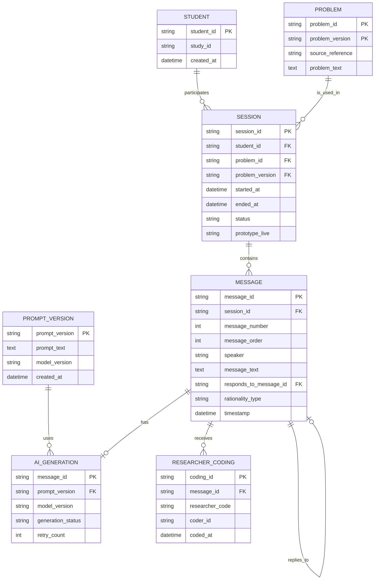

# 삼각비 연구용 AI 챗봇 데이터 설계

## 1. 문서 목적

이 문서는 삼각비 문제를 해결하는 학생과 AI 챗봇의 대화를 연구자료로 저장하기 위한 설계안이다.

아직 코드나 데이터베이스를 만들지 않는다. 실제 저장 전에 연구자가 항목과 보안 기준을 확인하는 것이 목적이다.

## 2. 기본 구조

학생 한 명은 여러 번 활동할 수 있고, 한 활동에는 여러 학생 발화와 AI 질문이 연결된다.

```text
학생 1명
  └─ 여러 활동(session)
       └─ 문제 1개
            └─ 여러 발화(message)
                 ├─ 학생 발화
                 └─ AI 질문
```

- `student_id`: 학생을 구분하는 가명 ID
- `session_id`: 한 번의 활동을 구분하는 ID
- `message_id`: 한 번의 발화 또는 AI 질문을 구분하는 ID

학생 실명은 저장하지 않고 연구용 가명 ID를 사용하는 것을 기본으로 제안한다.

## 3. 데이터 관계도



쉽게 말하면:

- `students`: 누구의 활동인지 연결한다.
- `sessions`: 한 번의 문제 풀이 활동을 묶는다.
- `problems`: 어떤 삼각비 문제를 사용했는지 기록한다.
- `messages`: 학생 발화와 AI 질문을 시간 순서로 저장한다.
- `prompt_versions`: AI에 적용한 프롬프트 원문을 버전별로 보관한다.
- `researcher_codings`: 연구자가 나중에 대화를 분석한 코드를 별도로 보관한다.

## 4. 항목 설명표

### 4.1 학생(`students`)

| 항목 | 설명 | 예시 |
|---|---|---|
| `student_id` | 연구용 가명 학생 ID | `S001` |
| `study_id` | 연구 프로젝트 ID | `TRIG_CHATBOT_2026` |
| `created_at` | 학생 ID 등록 시각 | `2026-10-15T09:00:00+09:00` |

실명, 전화번호, 학교명, 이메일은 이 테이블에 넣지 않는 것을 기본으로 한다. 실명과 가명 ID 연결표가 필요하면 연구자료와 분리해 보호한다.

### 4.2 활동(`sessions`)

| 항목 | 설명 | 예시 |
|---|---|---|
| `session_id` | 한 활동의 고유 ID | `SES_20261015_0001` |
| `student_id` | 활동한 학생 ID | `S001` |
| `problem_id` | 사용한 문제 ID | `TRIG_138_01` |
| `problem_version` | 문제 문구·그림 버전 | `v1.0` |
| `started_at` | 활동 시작 시각 | `2026-10-15T09:10:00+09:00` |
| `ended_at` | 활동 종료 시각. 진행 중이면 null | `2026-10-15T09:18:20+09:00` |
| `status` | 진행·종료·중단 상태 | `in_progress`, `completed`, `abandoned`, `error` |
| `end_reason` | 종료 또는 중단 이유 | `student_completed` |
| `prototype_live` | 예시 기능인지 실제 운영인지 | `prototype` 또는 `live` |

활동이 끝난 경우에만 `ended_at`을 기록한다. 저장 오류로 정상 종료되지 않으면 `status=error`와 오류 정보를 남긴다.

### 4.3 문제(`problems`)

| 항목 | 설명 | 예시 |
|---|---|---|
| `problem_id` | 문제 관리 ID | `TRIG_138_01` |
| `problem_version` | 원문·그림 버전 | `v1.0` |
| `problem_text` | 학생에게 보여준 문제 문장 | 승인된 문제 문구 |
| `source_reference` | 원본 출처 | `비상 중3 삼각비 PDF p.7 / 교과서 p.138` |
| `image_reference` | 사용 그림 버전 | `problem_TRIG_138_01_v1.png` |
| `answer_reference` | 정답 확인 자료 출처 | 연구자 확인 자료 |

첫 프로토타입 문제는 ∠B=90°, AB=24, BC=7, AC=25인 직각삼각형에서 ∠A와 ∠C의 sin, cos, tan을 각각 구하는 문제다.

### 4.4 대화 발화(`messages`)

| 항목 | 설명 | 예시 |
|---|---|---|
| `message_id` | 발화 고유 ID | `MSG_0003` |
| `session_id` | 활동 연결 ID | `SES_20261015_0001` |
| `message_number` | 사람이 이해하기 쉬운 발화 번호 | `3` |
| `message_order` | 정렬용 순서 번호 | `3` |
| `speaker` | 발화자 | `student` 또는 `ai` |
| `message_text` | 실제 발화 원문 | `∠A에서 7은 반대쪽이에요.` |
| `responds_to_message_id` | 응답 대상 발화 번호 | `MSG_0002` |
| `rationality_type` | AI 질문 유형 | AI만 값, 학생은 null |
| `timestamp` | 발화 기록 시각 | `2026-10-15T09:12:30+09:00` |
| `prototype_live` | 예시 질문인지 실제 AI 질문인지 | `prototype` 또는 `live` |
| `client_event_id` | 중복 전송 방지 ID | `evt_abc123` |

`speaker`는 `student`, `ai`, 필요할 때만 `system`을 사용한다.

## 5. `rationality_type` 저장 규칙

학생 발화의 `rationality_type`은 항상 `null`이다.

AI 질문에는 다음 중 하나만 저장한다.

- `epistemic`: 수학적 근거와 타당성을 묻는 질문
- `teleological`: 목표와 풀이 전략의 연결을 묻는 질문
- `communicative`: 표현과 설명을 명료하게 하는 질문

AI 질문 유형을 판단할 수 없거나 생성에 실패하면 임의의 유형을 넣지 않고 `null`과 오류 상태를 저장한다.

## 6. AI 관련 데이터

### 6.1 프롬프트 버전(`prompt_versions`)

| 항목 | 설명 | 예시 |
|---|---|---|
| `prompt_version` | 프롬프트 버전 ID | `rq-trig-v1.0` |
| `prompt_text` | 실제 적용한 원문 | 시스템 프롬프트 전체 |
| `change_summary` | 변경 내용 | `반복 질문 방지 규칙 추가` |
| `model_version` | 함께 기록할 모델 버전 | `model-name-version` |
| `created_at` | 버전 생성 시각 | `2026-10-15T08:50:00+09:00` |
| `approved_by` | 연구자 확인자 | `researcher_01` |

프롬프트를 바꿀 때 기존 내용을 덮어쓰지 않고 새 버전을 만든다.

### 6.2 AI 생성 기록(`ai_generations`)

| 항목 | 설명 | 예시 |
|---|---|---|
| `message_id` | 생성된 AI 질문 ID | `MSG_0002` |
| `prompt_version` | 적용 프롬프트 버전 | `rq-trig-v1.0` |
| `model_version` | 사용 모델 버전 | `model-name-version` |
| `generation_status` | 생성 상태 | `success`, `failed`, `retrying` |
| `request_id` | 외부 AI 요청 ID | `req_123` |
| `error_code` | 실패 코드 | `timeout` |
| `retry_count` | 재시도 횟수 | `1` |
| `created_at` | 요청 시각 | `2026-10-15T09:12:31+09:00` |

AI 생성에 실패한 요청은 실제 AI 질문이 전달된 것으로 기록하지 않는다. 준비된 예시 질문을 사용했다면 `prototype_live=prototype`으로 구분한다.

## 7. 연구자의 사후 분석 코드

AI가 선택한 질문 유형과 연구자의 사후 분석 코드는 서로 다른 기록으로 관리한다.

### AI가 선택한 유형

`messages.rationality_type`에 저장한다.

- 생성 시점에 기록
- `epistemic`, `teleological`, `communicative` 중 하나

### 연구자 분석 기록(`researcher_codings`)

| 항목 | 설명 | 예시 |
|---|---|---|
| `coding_id` | 분석 기록 ID | `CODE_0001` |
| `message_id` | 분석 대상 발화 | `MSG_0003` |
| `researcher_code` | 연구자가 붙인 코드 | `근거_대변확인` |
| `analysis_memo` | 분석 메모 | `학생이 변 BC를 대변으로 설명함` |
| `coder_id` | 분석자 ID | `researcher_01` |
| `coding_version` | 분석 기준 버전 | `coding-v1.0` |
| `coded_at` | 분석 시각 | `2026-10-20T14:00:00+09:00` |

AI가 `epistemic`으로 질문했더라도 연구자는 별도의 분석 코드를 부여할 수 있다.

## 8. 가상 대화 로그 예시

아래 자료는 실제 학생 자료가 아닌 가상 예시다.

### 활동 기록

```json
{
  "session_id": "SES_20261015_0001",
  "student_id": "S001",
  "problem_id": "TRIG_138_01",
  "problem_version": "v1.0",
  "started_at": "2026-10-15T09:10:00+09:00",
  "ended_at": "2026-10-15T09:18:20+09:00",
  "status": "completed",
  "end_reason": "student_completed",
  "prototype_live": "prototype"
}
```

### 발화 기록

```json
[
  {
    "message_id": "MSG_0001",
    "session_id": "SES_20261015_0001",
    "message_number": 1,
    "message_order": 1,
    "speaker": "student",
    "message_text": "∠A에서 7은 반대쪽이고 25는 빗변이라고 생각했어요.",
    "responds_to_message_id": null,
    "rationality_type": null,
    "timestamp": "2026-10-15T09:12:20+09:00",
    "prototype_live": "prototype",
    "client_event_id": "evt_001"
  },
  {
    "message_id": "MSG_0002",
    "session_id": "SES_20261015_0001",
    "message_number": 2,
    "message_order": 2,
    "speaker": "ai",
    "message_text": "∠A를 기준으로 보았을 때, 길이 7인 변은 어떤 위치의 변인가요?",
    "responds_to_message_id": "MSG_0001",
    "rationality_type": "epistemic",
    "timestamp": "2026-10-15T09:12:21+09:00",
    "prototype_live": "prototype",
    "client_event_id": "evt_002"
  },
  {
    "message_id": "MSG_0003",
    "session_id": "SES_20261015_0001",
    "message_number": 3,
    "message_order": 3,
    "speaker": "student",
    "message_text": "변 BC이고 ∠A의 대변이에요.",
    "responds_to_message_id": "MSG_0002",
    "rationality_type": null,
    "timestamp": "2026-10-15T09:13:10+09:00",
    "prototype_live": "prototype",
    "client_event_id": "evt_003"
  }
]
```

### 사후 분석 예시

```json
{
  "coding_id": "CODE_0001",
  "message_id": "MSG_0003",
  "researcher_code": "근거_대변확인",
  "analysis_memo": "학생이 변 BC를 대변으로 정확히 설명함",
  "coder_id": "researcher_01",
  "coding_version": "coding-v1.0",
  "coded_at": "2026-10-20T14:00:00+09:00"
}
```

## 9. 저장 실패·중복·새로고침·재시도

### 저장 실패

1. 요청을 `pending`으로 기록한다.
2. 성공 응답을 받은 경우에만 `saved`로 바꾼다.
3. 실패하면 `failed`, 오류 시각, 오류 코드를 기록한다.
4. 학생에게는 저장 실패와 재시도 방법을 안내한다.
5. 실패를 저장 완료로 표시하거나 조용히 버리지 않는다.

### 중복 전송

각 요청에 `client_event_id`를 붙인다.

- 같은 ID가 다시 도착하면 새 기록을 만들지 않는다.
- 서버가 이미 저장한 결과를 다시 알려준다.
- 제출 버튼은 처리 중 잠시 비활성화한다.

### 새로고침

임시 저장 대상으로 다음을 제안한다.

- `session_id`
- 마지막 저장 `message_order`
- 서버에 아직 전달하지 못한 발화
- 임시 저장 시각

새로고침 후 “이전 활동을 이어갈까요?”를 보여주고, 연구자가 재개를 허용한 경우에만 계속한다.

### 재시도

- 네트워크 오류나 일시적 서버 오류만 자동 재시도한다.
- 같은 `client_event_id`로 재시도한다.
- 재시도 횟수와 마지막 오류를 기록한다.
- AI 생성 실패를 가상 질문으로 몰래 대체하지 않는다.
- 예시 질문으로 전환했다면 `prototype_live=prototype`으로 기록한다.

## 10. 상태값

### 활동 상태

| 값 | 의미 |
|---|---|
| `in_progress` | 활동 진행 중 |
| `completed` | 정상 종료 |
| `abandoned` | 학생 중단 또는 이탈 |
| `error` | 저장·통신 오류 |

### 저장 상태

| 값 | 의미 |
|---|---|
| `pending` | 저장 결과 대기 중 |
| `saved` | 저장 성공 확인 |
| `failed` | 저장 실패 |
| `retrying` | 재시도 중 |

학생 화면에는 `saved`일 때만 “저장되었습니다”라고 표시한다.

## 11. 개인정보·접근 권한 원칙

- 학생은 다른 학생의 기록을 조회할 수 없어야 한다.
- 연구자만 원문 대화와 분석 코드를 조회·내보내야 한다.
- 학생 ID와 실명 연결표는 대화 로그와 분리한다.
- API 비밀키와 DB 관리자 키는 학생 브라우저에 넣지 않는다.
- 실제 연구 운영 전 RLS와 최소 권한 정책을 확정한다.
- 이 문서만으로 실제 보안이 완료되는 것은 아니다.

## 12. 연구자용 내보내기

### JSON

대화 순서, 원문, 프롬프트 버전, AI 질문 유형을 모두 보존한다.

### CSV

분석용으로 다음 열을 권장한다.

```text
student_id,session_id,problem_id,problem_version,message_id,message_number,message_order,speaker,message_text,responds_to_message_id,rationality_type,researcher_code,timestamp,prompt_version,model_version,prototype_live
```

내보내기 파일에도 학생 대화가 포함될 수 있으므로 접근 권한을 제한한다.

## 13. 연구자가 결정할 사항

1. 새로고침 후 이어하기 허용 여부
2. 재응시 허용 여부
3. “모르겠어요”를 몇 번까지 유효 응답으로 볼지
4. 무관한 입력이 반복될 때 중단 여부
5. AI 생성 실패 시 중단할지, 승인된 프로토타입 질문으로 전환할지
6. 연구자 분석자를 한 명으로 할지 여러 명으로 할지
7. 실제 자료 보관 기간과 삭제 기준
8. 학생이 자신의 기록을 확인할 수 있는 범위

## 14. 현재 상태

- [x] 학생 1명과 여러 활동의 관계 설계
- [x] 활동과 문제의 관계 설계
- [x] 학생 발화와 AI 질문의 순서·응답 관계 설계
- [x] AI 질문 유형과 연구자 분석 코드 분리
- [x] 프롬프트·모델 버전 저장 항목 설계
- [x] 저장 실패·중복·새로고침·재시도 처리 제안
- [ ] 연구자 검토
- [ ] 화면 구현 계획 작성
- [ ] 코드 작성
- [ ] 데이터베이스 구현

이 문서는 연구자 확인 전의 설계안이다. 다음 단계로 넘어가기 전에 13절의 결정 사항을 검토한다.
